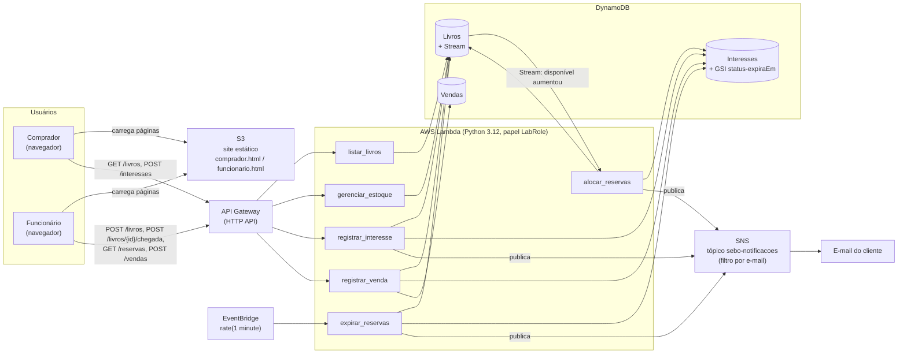
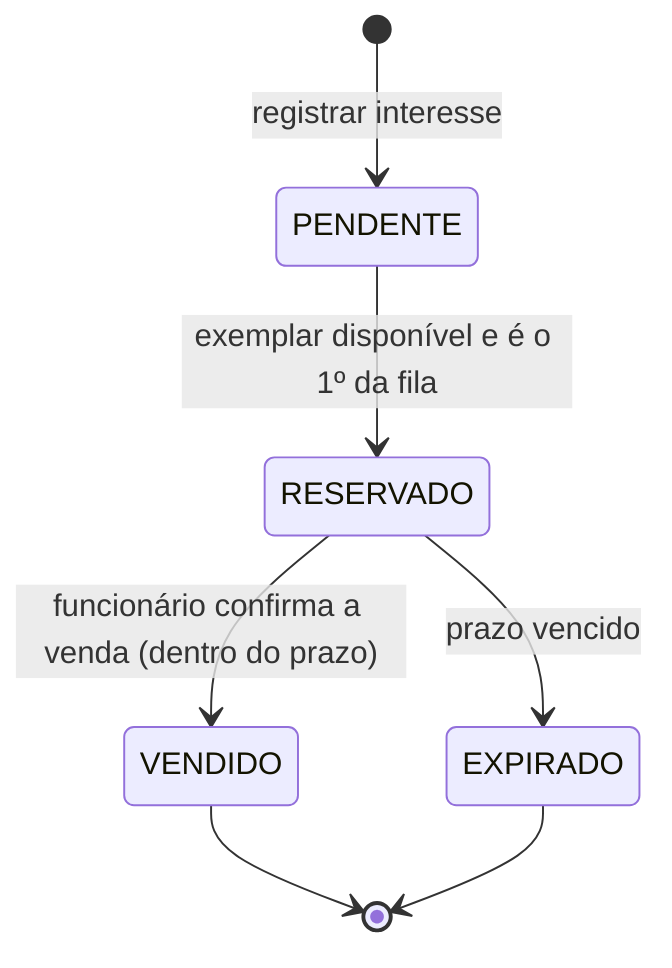
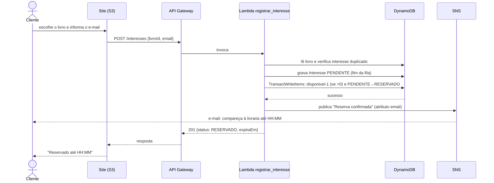
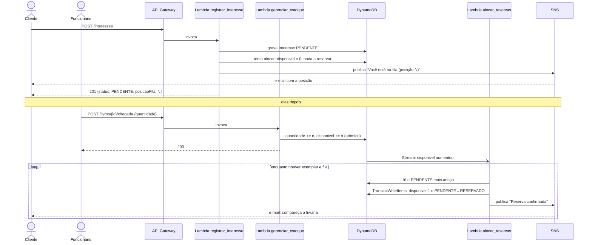
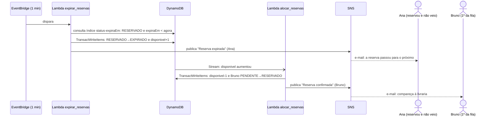
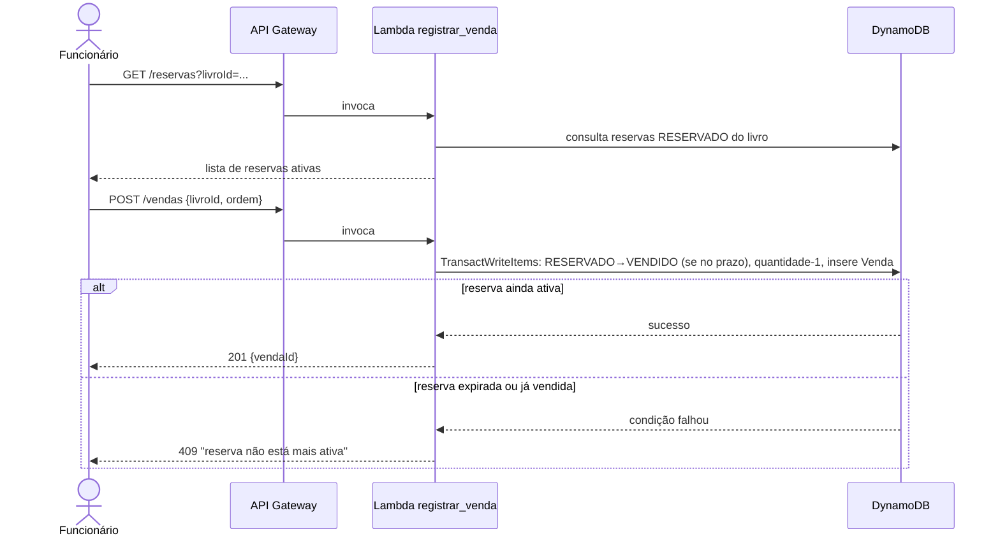

# Relatório — Sebo na Nuvem

**INF1304 Distribuição e Concorrência — Trabalho 2 (2026/2)**

| | |
|---|---|
| **Integrantes** | _[preencher: nomes e matrículas]_ |
| **Repositório** | https://github.com/GabrielMM47/inf1304-trab2 |
| **Conta da AWS Academy** | _[informada no EaD]_ — curso *AWS Academy Learner Lab*, região `us-east-1`, stack CloudFormation `sebo` |
| **Site (comprador)** | http://sebo-sitebucket-mdramgu5hxbp.s3-website-us-east-1.amazonaws.com/comprador.html |
| **Site (funcionário)** | http://sebo-sitebucket-mdramgu5hxbp.s3-website-us-east-1.amazonaws.com/funcionario.html |

---

## 1. O que foi implementado

Uma aplicação para um sebo, totalmente *serverless* na AWS. O cliente informa, numa página web, o livro em que tem interesse:

- **Se houver exemplar disponível**, o exemplar fica **reservado** para ele por um prazo e ele recebe um e-mail para comparecer à livraria e efetivar a compra.
- **Se não houver**, ele entra numa **fila de espera daquele livro, por ordem de chegada**, e recebe um e-mail com sua posição. Quando um exemplar chegar (ou a reserva de alguém expirar), o **primeiro da fila** recebe a reserva e o e-mail.
- **Se o cliente não comprar dentro do prazo**, a reserva expira, ele é avisado por e-mail e o exemplar passa automaticamente para o próximo da fila.

O funcionário usa outra página para cadastrar livros, registrar a chegada de exemplares, ver as reservas ativas e confirmar a venda no balcão. Livros, interesses (fila e reservas) e vendas ficam no banco para controle de estoque e de vendas.

**Requisitos do enunciado:**

| Requisito | Como foi atendido |
|---|---|
| Pelo menos três funções Lambda | **Seis** Lambdas, cada uma com uma responsabilidade (seção 3.1) |
| Pelo menos uma tabela em banco de dados | **Três** tabelas no DynamoDB: `Livros`, `Interesses`, `Vendas` |
| Envio de e-mail | Amazon SNS (protocolo e-mail), com filtro por cliente |
| Interface com usuário | Duas páginas web (comprador e funcionário) hospedadas no S3 |
| Cliente já inscrito no tópico | Inscrição feita pelo console da AWS (ou pelo script `scripts/inscrever_cliente.sh`) |

## 2. Diagrama em blocos

## 3. Componentes

### 3.1 Funções Lambda

| Função | Disparada por | Responsabilidade |
|---|---|---|
| `listar_livros` | `GET /livros` | Catálogo com quantidade total e disponível |
| `gerenciar_estoque` | `POST /livros`, `POST /livros/{id}/chegada` | Cadastro de livro; chegada de N exemplares (incremento atômico) |
| `registrar_interesse` | `POST /interesses` | Coloca o cliente no fim da fila do livro e tenta alocar imediatamente |
| `alocar_reservas` | **DynamoDB Stream** da tabela `Livros` | Quando o número de exemplares disponíveis aumenta (chegada ou expiração), reserva para os primeiros da fila e envia os e-mails |
| `expirar_reservas` | **EventBridge**, a cada 1 minuto | Expira reservas vencidas, devolve o exemplar e avisa o cliente |
| `registrar_venda` | `GET /reservas`, `POST /vendas` | Lista reservas ativas; confirma a venda de uma reserva |

As Lambdas são finas: traduzem o evento (HTTP, Stream ou agendamento) em chamadas ao pacote `sebo/`, onde está a lógica de negócio. Isso permitiu testar toda a lógica localmente.

### 3.2 Modelo de dados (DynamoDB, sob demanda)

| Tabela | Chave | Atributos principais |
|---|---|---|
| `Livros` | `livroId` | `titulo`, `autor`, `preco`, `quantidade` (exemplares na loja), `disponivel` (não reservados). Stream habilitado. |
| `Interesses` | `livroId` + `ordem` (`<timestamp>#<uuid>`) | `email`, `status` ∈ {`PENDENTE`, `RESERVADO`, `VENDIDO`, `EXPIRADO`}, `criadoEm`, `reservadoEm`, `expiraEm`. A ordenação de `ordem` dá a fila por ordem de chegada. Índice secundário `status-expiraEm` para achar reservas vencidas sem varrer a tabela. |
| `Vendas` | `vendaId` | `livroId`, `email`, `preco`, `data`, `ordemInteresse` |

Ciclo de vida de um interesse:

### 3.3 E-mail (SNS)

Um único tópico, `sebo-notificacoes`. Como um tópico SNS entrega cada mensagem a **todos** os inscritos, cada inscrição de cliente usa uma ***filter policy*** `{"email": ["cliente@exemplo.com"]}`, e as Lambdas publicam com o atributo de mensagem `email`. Assim, cada cliente recebe só as próprias mensagens. Os e-mails são normalizados (minúsculas, sem espaços) antes de gravar e de publicar, para o filtro sempre casar.

Mensagens enviadas: **Reserva confirmada** (com o horário limite), **Você está na fila** (com a posição) e **Reserva expirada**.

### 3.4 Infraestrutura

Toda a infraestrutura está descrita em um template CloudFormation (`infra/template.yaml`) e é criada com um comando (`./deploy.sh`). Todas as Lambdas usam o papel `LabRole`, já existente no Learner Lab (que não permite criar papéis IAM).

## 4. Concorrência e consistência

Esta é a parte central do trabalho. Várias Lambdas podem executar ao mesmo tempo sobre o mesmo livro: dois clientes pedindo o último exemplar no mesmo instante, o Stream alocando enquanto um cliente registra interesse, a varredura expirando uma reserva enquanto o funcionário tenta vendê-la. Nenhuma delas usa *locks*; a correção vem de **escritas condicionais e transações do DynamoDB** (`TransactWriteItems`), que são atômicas (tudo ou nada).

| Operação | Transação (todas as escritas ou nenhuma) |
|---|---|
| **Reservar** (único caminho para `RESERVADO`) | `Livros.disponivel -= 1` **se** `disponivel > 0` **e** `Interesse.status = RESERVADO` **se** `status = PENDENTE` |
| **Expirar** | `Interesse.status = EXPIRADO` **se** `status = RESERVADO e expiraEm < agora` **e** `Livros.disponivel += 1` |
| **Vender** | `Interesse.status = VENDIDO` **se** `status = RESERVADO e expiraEm > agora` **e** `Livros.quantidade -= 1` **e** inserir em `Vendas` |

Consequências:

- **Dois clientes nunca recebem o mesmo exemplar.** Se duas execuções leem `disponivel = 1` e tentam reservar, a primeira transação passa e a segunda falha na condição `disponivel > 0`; a perdedora relê o estado e para. O estoque nunca fica negativo.
- **A fila é respeitada.** Um interesse novo sempre entra como `PENDENTE` no fim da fila; só a rotina de alocação cria reservas, e sempre para o `PENDENTE` mais antigo. Quem chegou depois não passa na frente, mesmo que chegue no exato momento em que um exemplar é devolvido.
- **Não há venda de reserva vencida.** A condição `expiraEm > agora` recusa a venda mesmo que a varredura de expiração ainda não tenha rodado.
- **A alocação é idempotente.** O Stream pode entregar o mesmo evento mais de uma vez, ou duas alocações podem rodar juntas; como cada reserva depende das condições acima, repetir não causa efeito duplicado.
- **Desacoplamento pelo Stream.** Chegada de exemplares e expiração só mexem no estoque; a alocação para a fila acontece de forma assíncrona, disparada pela mudança na tabela `Livros`.

## 5. Diagramas UML de sequência

### 5.1 Interesse em livro com exemplar disponível

### 5.2 Interesse sem estoque → chegada do livro → reserva

### 5.3 Reserva não retirada → expiração → próximo da fila

### 5.4 Venda no balcão

## 6. Instalação

Resumo; o passo a passo completo está no [README](../README.md).

1. No curso *AWS Academy Learner Lab*: **Start Lab**, esperar o indicador ficar verde, copiar as credenciais de **AWS Details → AWS CLI** para `~/.aws/credentials` (ou usar o **CloudShell** do console).
2. Clonar o repositório e executar `./deploy.sh`. O script empacota o código das Lambdas, envia ao S3, cria/atualiza a stack CloudFormation `sebo`, gera a configuração do site com a URL da API e publica as páginas. Ao final, imprime as URLs do site, da API e o ARN do tópico.
3. Opcional: `./scripts/popular.sh` cadastra 5 livros de exemplo.
4. Inscrever os clientes no tópico `sebo-notificacoes` (console do SNS, protocolo e-mail, com a filter policy do próprio e-mail) e confirmar pelo link recebido. Alternativa: `./scripts/inscrever_cliente.sh <email>`.

Para remover tudo: `./destroy.sh`. Para deixar a aplicação implantada sem nada executando sozinho: `./scripts/pausar.sh` (e `./scripts/retomar.sh` antes de usar).

## 7. Operação

- **Comprador** (`comprador.html`): vê o catálogo, informa o e-mail e clica em **Tenho interesse**. A página mostra "Reservado até HH:MM" ou a posição na fila; o e-mail correspondente chega em seguida.
- **Funcionário** (`funcionario.html`): cadastra livros, registra a chegada de exemplares (o que dispara a reserva para a fila), lista as reservas ativas de um livro e confirma a venda.
- **Prazo de reserva:** 2 minutos por padrão, para a demonstração. Para um valor realista: `PRAZO_RESERVA_MINUTOS=2880 ./deploy.sh` (48 h) ou pelo parâmetro `PrazoReservaMinutos` da stack no console do CloudFormation.

## 8. Testes e resultados

### 8.1 Testes automatizados locais

O desenvolvimento seguiu TDD (teste falhando → código → refatoração), com DynamoDB e SNS simulados pela biblioteca `moto`. **91 testes passando**, cobrindo: reserva transacional (inclusive com estado obsoleto, simulando duas execuções concorrentes), alocação por ordem de chegada, quem chega depois não fura a fila, expiração, venda de reserva vencida ainda não varrida (recusada), venda duplicada (recusada), validação de entradas da API, serialização, handlers do Stream e do agendamento, e o template CloudFormation (validado com `cfn-lint`, uso do `LabRole`, ausência de recursos IAM, rotas da API).

### 8.2 Teste de ponta a ponta na AWS (`scripts/teste_e2e.py`)

Executado contra a stack implantada na conta da AWS Academy. Para conferir os e-mails sem depender de uma caixa de entrada, o script inscreve no tópico duas filas SQS temporárias: uma sem filtro (recebe tudo) e outra com a filter policy de um cliente.

| Verificação | Resultado |
|---|---|
| Cadastrar livro com 1 exemplar | OK |
| Ana registra interesse com estoque → `RESERVADO` | OK |
| Ana recebe "Reserva confirmada" | OK |
| Bruno sem estoque → `PENDENTE`, posição 1 | OK |
| Bruno recebe "Você está na fila" | OK |
| Caio sem estoque → `PENDENTE`, posição 2 | OK |
| Interesse duplicado do Bruno → 409 | OK |
| Chegada de 1 exemplar | OK |
| Stream reserva para o Bruno (1º da fila) e envia e-mail | OK |
| Caio continua na fila (não furou) | OK |
| Venda da reserva ativa do Bruno → 201 | OK |
| Segunda venda da mesma reserva → 409 | OK |
| Ana (não compareceu) recebe "Reserva expirada" | OK |
| Exemplar devolvido passa para o Caio (próximo da fila) | OK |
| Estoque final: quantidade 1, disponível 0 | OK |
| Filtro SNS: a caixa da Ana só recebeu mensagens da Ana | OK |

**16/16 verificações OK.**

### 8.3 Teste de concorrência na AWS (`scripts/teste_concorrencia.py`)

Requisições disparadas simultaneamente (sincronizadas por uma barreira) contra a API real:

| Cenário | `RESERVADO` | `PENDENTE` | Erros | Estoque final |
|---|---|---|---|---|
| 20 clientes, 1 exemplar | **1** | 19 | 0 | quantidade 1, disponível 0 |
| 30 clientes, 3 exemplares | **3** | 27 | 0 | quantidade 3, disponível 0 |

Nenhum exemplar foi reservado duas vezes e o estoque disponível nunca ficou negativo.

## 9. O que funcionou e o que não funcionou

### Funcionou

- Todo o fluxo pedido no enunciado: interesse com estoque → e-mail para comparecer à livraria; interesse sem estoque → aviso por e-mail quando o item chega.
- Reserva com prazo, fila por ordem de chegada, expiração automática e passagem ao próximo da fila.
- Controle de concorrência sem *locks*, comprovado localmente e na AWS (seção 8).
- E-mail direcionado por cliente com filter policy do SNS (comprovado pela fila filtrada no teste de ponta a ponta).
- Implantação e remoção completas com um comando cada, na conta do Learner Lab.

### Não funcionou / pendências

- _[atualizar]_ **E-mail em caixa de entrada real:** a entrega do SNS foi verificada por filas SQS inscritas no tópico; a confirmação com um e-mail real inscrito ficou pendente porque a sessão do Learner Lab caiu antes da inscrição (abaixo).
- **Instabilidade do Learner Lab:** durante os testes, as credenciais da sessão foram canceladas pela própria AWS Academy (política `voc-cancel-cred`) e o botão **Start Lab** passou a voltar ao estado "account deactivated". A aplicação implantada continuou funcionando normalmente (site e API respondendo), mas não foi possível administrar a conta até a sessão ser restabelecida. _[atualizar com o desfecho]_

### Limitações conhecidas

- **Sem autenticação:** a página do funcionário não tem senha; o cliente se identifica só pelo e-mail.
- **Interesse duplicado não é transacional:** dois pedidos idênticos do mesmo e-mail enviados exatamente ao mesmo tempo podem ambos entrar na fila (a verificação e a gravação não são atômicas). Não afeta a correção das reservas, só pode gerar uma entrada repetida na fila.
- **E-mail perdido se o SNS falhar:** a reserva é gravada antes da publicação; se a publicação falhar, a reserva continua válida, mas o cliente não é avisado.
- **Atraso na expiração:** a varredura roda a cada 1 minuto, então uma reserva pode permanecer ativa até cerca de 1 minuto além do prazo (a venda, porém, já é recusada no horário exato).
- **Inscrição manual:** cada cliente precisa estar inscrito e ter confirmado a inscrição no tópico, com o filtro do próprio e-mail, conforme simplificação permitida pelo enunciado.

## 10. Decisões de projeto

| Decisão | Alternativas consideradas | Motivo |
|---|---|---|
| **CloudFormation + `deploy.sh`** | Criar tudo pelo console; SAM/Terraform | Reproduzível com um comando, qualquer integrante consegue implantar; SAM/Terraform exigiriam ferramentas extras e conflitam com as restrições do Learner Lab (papéis IAM, credenciais temporárias) |
| **Reserva com prazo e fila** | Apenas avisar que o livro está disponível | Sem reserva, dois clientes poderiam ir à loja atrás do mesmo exemplar; com reserva, o problema de concorrência é tratado explicitamente |
| **Transações condicionais do DynamoDB** | Locks distribuídos; filas FIFO | Atômicas, sem servidor de lock, sem estado extra para gerenciar |
| **Alocação disparada pelo DynamoDB Stream** | Chamar a alocação dentro de cada Lambda que devolve estoque | Desacopla chegada/expiração do envio de e-mails e centraliza a regra de quem recebe o exemplar |
| **Varredura agendada a cada minuto** | TTL do DynamoDB | O TTL pode atrasar até 48 h para apagar um item, inaceitável para um prazo de minutos |
| **SNS com filter policy** | SES | O SES costuma ser bloqueado no Learner Lab; o enunciado já pressupõe inscrição em tópico |
| **Página web estática no S3** | CLI local | Interface acessível de qualquer navegador e totalmente hospedada na AWS |
